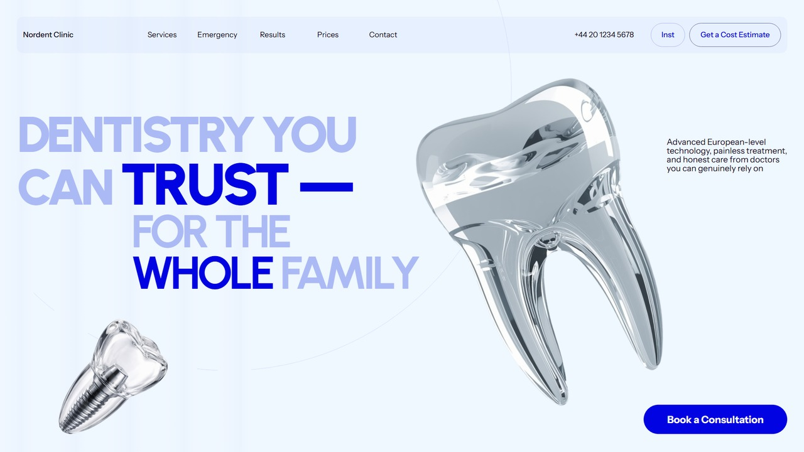
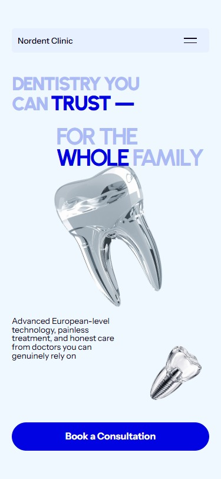

# Nordent Clinic

A responsive dental landing page with a bold blue identity, glass-inspired visuals and thoughtful interaction.

**UI design: UX.RONA** · **Frontend: TypeScript, Vite, GSAP**



## The experience

Thirteen sections bring services, doctor profiles, pricing, comparisons, location information and an enquiry form into one consistent interface.

- Responsive desktop, tablet and mobile layouts.
- GSAP hero entrances and selected card reveals.
- Photo zoom within static Before / After cards.
- Smooth FAQ accordion with keyboard support.
- Booking actions preselect the relevant service or doctor.
- Required-field, email, consent and future-date validation.
- Reduced-motion support and self-hosted fonts.



## Run locally

Use Node.js 24 and pnpm 11.

```sh
pnpm install --frozen-lockfile
pnpm dev
```

Alternatively, use `npm install` and `npm run dev`.

```sh
pnpm build
pnpm preview
```

The production output is in dist/. Relative asset paths support hosting from a repository subdirectory.

## Booking behaviour

The form prepares an email enquiry in the visitor's email application. The visitor sends that email. There is no appointment-management backend and the interface does not claim that a booking has been confirmed.

## Source

- src/main.ts: page structure, interactions and GSAP animations.
- src/content.json: page copy and image references.
- src/*.css: section layouts and responsive styling.
- public/images and public/fonts: local assets.
- [Implementation details](docs/IMPLEMENTATION.md)
- [Verification and limitations](VERIFICATION.md)

## Credits

UI design: **UX.RONA**. The implementation follows the supplied Figma design and thirteen visual exports. Images come from the supplied design. Fonts are self-hosted with their included licenses.

Clinic social icons are supplied visually; their profile links await confirmed clinic URLs. Contact details and clinical copy belong to the supplied design and should be verified before use for a real practice.

No open-source license is specified for this repository; supplied visuals retain their original rights.
